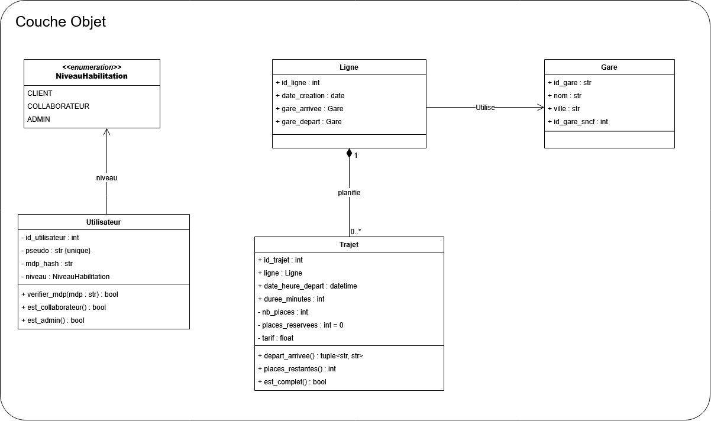
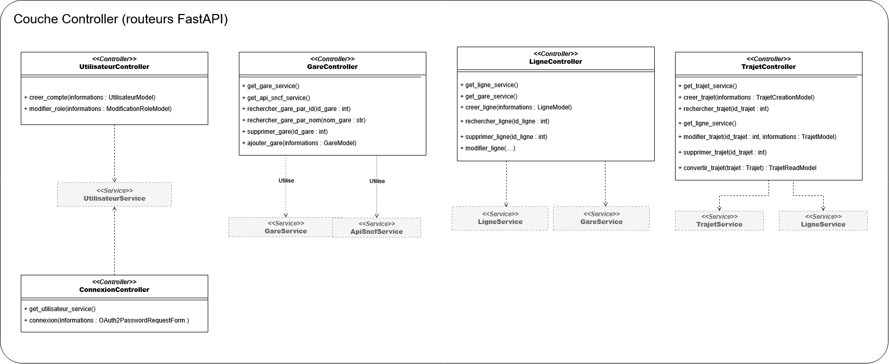
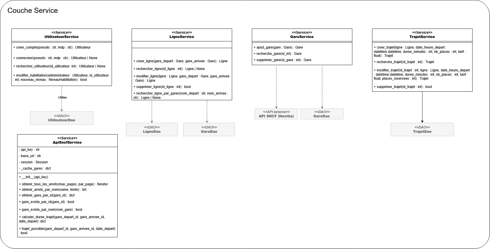
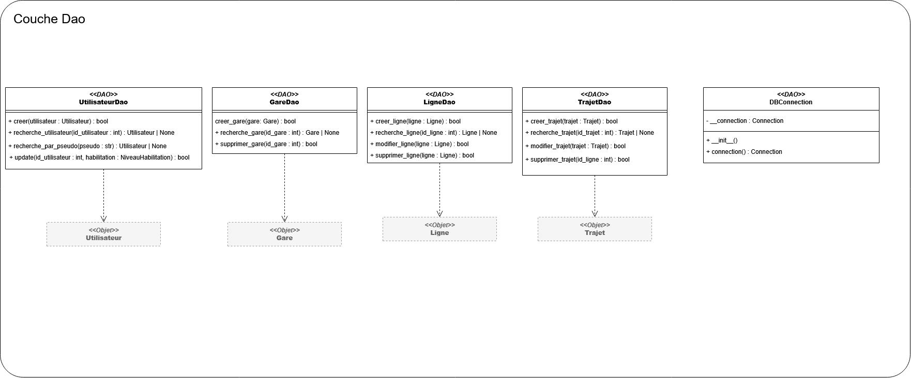

--- 
citeproc: false
nocite: "@*"
format:
  html:
    code-tools: true
  typst:
    papersize: a4
    margin:
      x: 1.5cm
      y: 2.0cm
    section-numbering: 1.1.a
    mainfont: "Libertinus Serif"
    fontsize: 11pt
---


```{=typst}
#import "model.typ": project_template

#show: body => project_template(
  title: [Trajecto : création d'une API de gestion de trajets ferroviaires],
  subtitle: [Rapport final],
  team: [Équipe 10],
  authors: ([Benjamin Blanc], [Manon Duquesne], [Hugo Lhommeau], [Jérémie L'Hostis], [Alexandre Yu]),
  tutor: [Kévin Leroy],
  project: [Projet Informatique de 2ème année - Année 2026-2027],
  body
)
```

## Introduction {.unnumbered}



## Organisation

### Chronologie du projet

### Répartition des rôles



## Modélisation finale

### Diagramme de classes final

#### Couche Objet {.unlisted}

{fig-align="center" width="120%"}

#### Couche Controller {.unlisted}

{fig-align="center" width="120%"}

#### Couche Service {.unlisted}

{fig-align="center" width="120%"}

#### Couche Dao {.unlisted}


{fig-align="center" width="120%"}

### Schéma de base de données final



## Architecture

### Choix techniques

### Architecture globale

### Exemple détaillé d'une fonctionnalité



## Fonctionnalités implémentées

### Gestion des comptes utilisateur

#### Description {.unlisted}

#### Guide d'usage {.unlisted}

### Gestion des lignes d'exploitation

#### Description {.unlisted}

#### Guide d'usage {.unlisted}

### Gestion des trajets proposés

#### Description {.unlisted}

#### Guide d'usage {.unlisted}

### Recherche d'un trajet

#### Description {.unlisted}

#### Guide d'usage {.unlisted}

### Positionnement commercial

#### Description {.unlisted}

#### Guide d'usage {.unlisted}



## Tests

### Tests unitaires

### Tests d'intégration

### Résultats



## Bilans individuels

### Jérémie L'Hostis

### Alexandre Yu

### Hugo Lhommeau

### Benjamin Blanc

### Manon Duquesne



## Conclusion {.unnumbered}