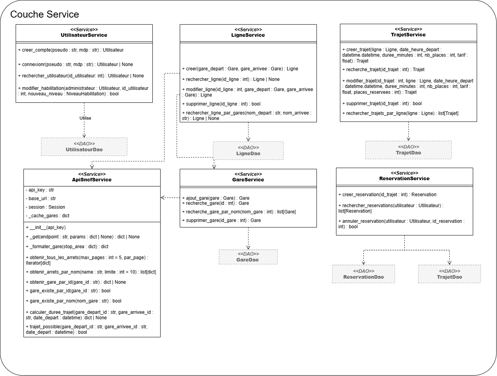

--- 
citeproc: false
nocite: "@*"
format:
  html:
    code-tools: true
  typst:
    papersize: a4
    margin:
      x: 1.5cm
      y: 2.0cm
    section-numbering: 1.1.a
    mainfont: "Libertinus Serif"
    fontsize: 11pt
---


```{=typst}
#import "model.typ": project_template

#show: body => project_template(
  title: [Trajecto : création d'une API de gestion de trajets ferroviaires],
  subtitle: [Rapport final],
  team: [Équipe 10],
  authors: ([Benjamin Blanc], [Manon Duquesne], [Hugo Lhommeau], [Jérémie L'Hostis], [Alexandre Yu]),
  tutor: [Kévin Leroy],
  project: [Projet Informatique de 2ème année - Année 2026-2027],
  body
)
```

## Introduction {.unnumbered}



## Organisation

### Chronologie du projet

### Répartition des rôles



## Modélisation finale

### Diagramme de classes final

#### Couche Objet {.unlisted}

{fig-align="center" width="120%"}

#### Couche Controller {.unlisted}

{fig-align="center" width="120%"}

#### Couche Service {.unlisted}

{fig-align="center" width="120%"}

#### Couche Dao {.unlisted}


{fig-align="center" width="120%"}

### Schéma de base de données final



### Choix techniques

### 3.2 Nos choix pour l'implémentation

Dans le cadre du développement de notre application de gestion de trajets ferroviaires, nous avons dû effectuer plusieurs choix technologiques afin de répondre aux besoins spécifiques du projet. Ces choix ont été guidés par la nécessité de construire une API performante, de garantir une gestion fiable des données et d'assurer la sécurité des interactions entre les différents utilisateurs. Voici les principales technologies retenues et les raisons qui ont motivé leur utilisation :

- **FastAPI pour la construction de l'API :** FastAPI est un framework Python moderne permettant de développer des API RESTful de manière rapide et efficace. Il offre notamment une documentation interactive générée automatiquement, une validation des données et une gestion simplifiée des requêtes HTTP. Dans notre projet, FastAPI permet de définir les différents endpoints nécessaires à la gestion des utilisateurs, des gares, des lignes, des trajets et des réservations. Sa documentation automatique, accessible via Swagger UI, facilite également les tests et la compréhension des fonctionnalités de notre application.

- **PostgreSQL pour la gestion des données :** PostgreSQL est un système de gestion de bases de données relationnelles open source, particulièrement adapté au stockage de données structurées. Notre application repose sur plusieurs entités liées entre elles, notamment les utilisateurs, les gares, les lignes, les trajets et les réservations. PostgreSQL permet de gérer efficacement ces relations tout en garantissant l'intégrité et la cohérence des données. L'utilisation de la base de données mise à disposition par l'ENSAI a également facilité le stockage centralisé des informations et le travail collaboratif.

- **L'API SNCF pour l'exploitation des données ferroviaires :** Afin de disposer d'informations relatives au réseau ferroviaire français, nous avons aussi utilisé l'API SNCF. Celle-ci permet d'accéder à des données externes concernant notamment les gares et les déplacements ferroviaires. Dans notre application, elle est notamment utilisée pour récupérer des informations permettant de déterminer la durée des trajets entre différentes gares. Son intégration nous évite de devoir constituer manuellement l'ensemble de ces données et permet de nous appuyer sur une source spécialisée.

- **JWT pour l'authentification et la gestion des accès :** Les JSON Web Tokens (JWT) constituent un mécanisme d'authentification reposant sur l'utilisation de jetons signés. Lorsqu'un utilisateur s'authentifie, un jeton peut lui être attribué afin de vérifier son identité lors des requêtes suivantes. Dans notre projet, ce système permet de sécuriser l'accès aux différentes fonctionnalités de l'API. Il est associé à une gestion des autorisations distinguant trois catégories d'utilisateurs : **CLIENT, COLLABORATEUR et ADMIN**. Chaque rôle dispose de permissions spécifiques, permettant notamment de restreindre certaines opérations de gestion aux utilisateurs habilités.

Ainsi, l'association de FastAPI, PostgreSQL, de l'API SNCF et des JWT permet de construire une application structurée, sécurisée et adaptée aux besoins de notre projet. Ces technologies répondent à des objectifs complémentaires : faciliter le développement de l'API, assurer la fiabilité du stockage des données, exploiter des informations ferroviaires externes et contrôler l'accès aux différentes fonctionnalités selon le profil de l'utilisateur.

### Architecture globale

L'architecture logicielle de notre application Trajecto repose sur une organisation en plusieurs couches, permettant de séparer les différentes responsabilités du programme. Cette structure favorise la modularité du code, facilite sa maintenance et permet de faire évoluer certaines fonctionnalités sans modifier l'ensemble de l'application. Chaque couche remplit ainsi un rôle spécifique, depuis la réception des requêtes des utilisateurs jusqu'à l'accès aux données stockées dans PostgreSQL ou récupérées depuis l'API SNCF.

Notre application s'articule autour de plusieurs composantes principales : la couche de contrôle (*Controller Layer*), la couche de services (*Service Layer*), la couche d'accès aux données (*DAO Layer*), les modèles métiers (*Business Objects*) et la couche de persistance (*Persistence Layer*). À celles-ci s'ajoute l'interaction avec l'API externe de la SNCF.

Voici l'arborescence de notre application :

```text
ensai-it-project-2a-team10/
├── backend/
│   ├── src/
│   │   ├── business_object/
│   │   ├── controller/
│   │   ├── dao/
│   │   ├── schema/
│   │   ├── service/
│   │   ├── utils/
│   │   └── main.py
│   ├── tests/
│   │   ├── tests_business_object/
│   │   └── tests_service/
│   ├── logging_config.yml
│   └── pyproject.toml
├── Diagrammes/
├── doc/
│   └── report/
│       └── rapport_final_equipe_10.qmd
├── README.md
└── requirements.txt
```
**La couche de contrôle (Controller Layer)** constitue le point d'entrée de notre application. Développée à l'aide du framework FastAPI, elle assure la communication entre les utilisateurs et les différentes fonctionnalités de Trajecto. Les interactions s'effectuent au moyen de requêtes HTTP, adressées à des endpoints organisés selon les principales entités de notre application : les utilisateurs, les gares, les lignes, les trajets et les réservations. Par exemple, l'endpoint `GET /trajet/` permet de rechercher des trajets entre deux gares, tandis que `POST /reservation/` permet d'effectuer une réservation. Le Controller réceptionne les requêtes, récupère les paramètres transmis, puis sollicite les traitements nécessaires à leur exécution. Il assure également la gestion des réponses HTTP, notamment en cas d'erreur ou lorsque les ressources demandées sont introuvables.

Cette couche intervient également dans la sécurisation de notre API. L'accès à la majorité des endpoints nécessite une authentification reposant sur l'utilisation de JSON Web Tokens (JWT). Lorsqu'un utilisateur se connecte via l'endpoint `/connexion/`, un jeton lui est attribué, qu'il doit ensuite transmettre lors de ses requêtes vers les endpoints protégés. Les autorisations dépendent de trois niveaux d'habilitation : CLIENT, COLLAB et ADMIN. Un CLIENT peut notamment consulter les trajets et gérer ses réservations, tandis qu'un COLLAB dispose de permissions supplémentaires pour créer, modifier ou supprimer des gares, des lignes et des trajets. Enfin, un ADMIN possède l'ensemble de ces droits et peut également modifier les habilitations des utilisateurs. Cette hiérarchisation permet de limiter l'accès aux fonctionnalités sensibles de notre application.

**La couche de services (Service Layer)** regroupe les traitements métiers nécessaires au fonctionnement de Trajecto. Elle constitue le cœur logique de l'application et permet de répondre aux demandes transmises par la couche de contrôle. Les traitements concernent notamment la gestion des trajets ferroviaires, la création de lignes entre différentes gares ou encore la réservation de places. Cette couche assure également la vérification des règles métiers propres à notre application. Par exemple, lors d'une réservation, le système doit vérifier l'existence du trajet demandé ainsi que la disponibilité des places avant de valider l'opération. De même, lors de l'annulation d'une réservation, le nombre de places réservées doit être actualisé afin de garantir la cohérence des disponibilités.

**La couche d'accès aux données (DAO Layer, pour Data Access Object)** assure les échanges entre les traitements de l'application et la base de données PostgreSQL. Elle permet de centraliser les opérations nécessaires à la consultation, à l'ajout, à la modification et à la suppression des informations. Ainsi, les traitements métiers peuvent s'appuyer sur des méthodes d'accès aux données sans avoir à gérer directement les requêtes SQL. Ce découpage permet de distinguer les opérations relatives au stockage des données de celles liées au fonctionnement métier de l'application.

**La couche de persistance (Persistence Layer)** correspond à notre base de données PostgreSQL. Celle-ci contient les différentes informations nécessaires au fonctionnement de Trajecto, réparties entre plusieurs tables représentant notamment les utilisateurs, les gares, les lignes, les trajets et les réservations. Les relations entre ces entités permettent de relier un trajet à une ligne ferroviaire, une ligne à ses gares de départ et d'arrivée, ou encore une réservation à un utilisateur et à un trajet. La base de données assure ainsi la conservation des informations, tandis que les opérations de consultation et de modification sont effectuées par l'intermédiaire de la couche d'accès aux données.

**Les modèles métiers (Business Objects)** représentent les principales entités manipulées dans notre application. Ils permettent de structurer les informations échangées entre les différentes composantes, notamment celles relatives aux gares, aux lignes, aux trajets, aux utilisateurs et aux réservations. En complément, les modèles de validation utilisés par FastAPI permettent de définir les données attendues dans les requêtes et les informations retournées dans les réponses. Cette organisation contribue à garantir la cohérence des données manipulées par notre API.

Enfin, **l'intégration de l'API SNCF** constitue une particularité importante de notre architecture. Contrairement aux informations stockées dans notre propre base de données, certaines données ferroviaires sont obtenues directement auprès d'un service externe. Notre application utilise notamment l'API SNCF pour rechercher des gares à partir de leur nom et récupérer des informations permettant de déterminer la durée d'un trajet. Lorsqu'un collaborateur crée un trajet via l'endpoint `POST /trajet/`, l'application exploite les noms des gares de départ et d'arrivée ainsi que la date et l'heure de départ pour obtenir une estimation de la durée auprès de l'API SNCF. Cette durée est ensuite associée au trajet créé. L'utilisation de cette API externe nous permet ainsi de compléter les données propres à Trajecto sans avoir à gérer manuellement l'ensemble des informations ferroviaires.

Le fonctionnement général de notre application repose donc sur les échanges entre ces différentes composantes. Lorsqu'un utilisateur effectue une requête depuis l'interface Swagger de FastAPI, celle-ci est réceptionnée par le Controller. Après validation des paramètres et vérification des éventuelles autorisations, les traitements nécessaires sont exécutés. Selon la fonctionnalité demandée, ils peuvent nécessiter la consultation ou la modification de données dans PostgreSQL, ou encore la récupération d'informations externes depuis l'API SNCF. Une fois les opérations terminées, les résultats sont retournés à la couche de contrôle, qui construit la réponse HTTP envoyée à l'utilisateur, généralement au format JSON.

Cette architecture permet donc de répartir les responsabilités entre les différentes composantes de Trajecto, tout en assurant leur communication. Elle facilite également les tests, la correction des erreurs et l'ajout de nouvelles fonctionnalités, sans nécessiter de modifications importantes dans l'ensemble du programme.

### Exemple détaillé d'une fonctionnalité

Afin d'illustrer le fonctionnement de notre application, nous allons détailler le processus de création d'un trajet ferroviaire par un collaborateur. Cette fonctionnalité mobilise les différentes couches de notre architecture, depuis l'authentification de l'utilisateur jusqu'à l'enregistrement du trajet dans la base de données PostgreSQL.

**Connexion et authentification de l'utilisateur**

L'utilisateur commence par se connecter à l'application à l'aide de son identifiant et de son mot de passe, notamment depuis l'interface Swagger. La requête `POST /connexion/` est reçue par le fichier Python du dossier `controller/` responsable de l'authentification. Celui-ci sollicite les traitements d'authentification, qui s'appuient sur les modules d'accès aux données du dossier `dao/` pour retrouver les informations de l'utilisateur dans PostgreSQL.

Après vérification des identifiants, l'application génère un JSON Web Token (JWT). Ce jeton, valable pendant sept jours, permet d'identifier l'utilisateur lors de ses prochaines requêtes sans qu'il ait à saisir de nouveau son mot de passe.

**Vérification du JWT et des habilitations**

Une fois connecté, le collaborateur peut demander la création d'un trajet en envoyant une requête `POST /trajet/`. Cette requête est dirigée vers le fichier Python du dossier `controller/` responsable des trajets.

Avant d'autoriser son exécution, FastAPI fait intervenir le module de sécurité chargé de vérifier le JWT transmis dans l'en-tête HTTP. Celui-ci contrôle la validité du jeton et l'identité de l'utilisateur, puis vérifie son niveau d'habilitation. La création d'un trajet nécessite au minimum le niveau `COLLAB` (niveau 2). Un utilisateur disposant uniquement du niveau `CLIENT` ne peut donc pas effectuer cette opération.

Si le jeton est absent, invalide ou expiré, l'application renvoie une erreur HTTP 401. Si l'utilisateur ne possède pas les autorisations nécessaires, la requête est refusée avec une erreur HTTP 403.

**Réception des informations et recherche de la ligne**

Une fois les autorisations vérifiées, le Controller chargé des trajets récupère les informations renseignées par le collaborateur : le nom de la gare de départ, le nom de la gare d'arrivée, la date et l'heure de départ, le nombre de places et le tarif.

Ces données sont validées à l'aide des modèles Pydantic définis dans les fichiers Python du dossier `schema/`. Le Controller transmet ensuite la demande au fichier du dossier `service/` responsable de la gestion des trajets.

Ce Service sollicite les opérations d'accès aux données de la couche `dao/` afin de rechercher dans PostgreSQL une ligne ferroviaire reliant les deux gares indiquées. Si cette ligne n'existe pas dans la base de données de l'application, une erreur HTTP 404 est renvoyée à l'utilisateur.

**Récupération de la durée auprès de l'API SNCF**

Lorsque la ligne existe, le traitement se poursuit par la détermination de la durée du trajet. Celle-ci n'est pas saisie manuellement par le collaborateur : elle est récupérée automatiquement grâce à l'API SNCF.

Le Service chargé des trajets fait intervenir le module Python responsable des communications avec cette API externe, en lui transmettant les informations nécessaires à la recherche d'un itinéraire, notamment les gares concernées et l'horaire de départ.

Si l'API SNCF ne permet pas de trouver un itinéraire correspondant, l'application renvoie une erreur HTTP 422. Dans le cas contraire, la durée obtenue est utilisée pour compléter les informations du trajet.

**Création et enregistrement du trajet**

Une fois les différentes vérifications effectuées, le Service prépare les données du nouveau trajet, représentées par les objets métiers définis dans le dossier `business_object/`.

Il sollicite ensuite le fichier Python du dossier `dao/` responsable des trajets, afin d'enregistrer le nouvel objet dans PostgreSQL. Le trajet est associé à la ligne ferroviaire identifiée précédemment et contient notamment sa date de départ, sa durée, son tarif et son nombre total de places. Le nombre de places réservées est initialisé à zéro.

Cette séparation entre le Service et le DAO permet de distinguer les règles métiers des opérations de lecture et d'écriture dans la base de données.

**Retour de la réponse à l'utilisateur**

Après l'insertion du trajet dans PostgreSQL, le DAO transmet le résultat au Service, qui le retourne au Controller. Ce dernier utilise le modèle de réponse défini dans la couche `schema/` pour construire la réponse HTTP au format JSON.

L'utilisateur reçoit alors les informations du trajet créé, notamment son identifiant, sa ligne ferroviaire, son horaire de départ, sa durée, son tarif et le nombre de places disponibles.

Cette fonctionnalité illustre ainsi la circulation des informations entre les différentes couches de notre application : le Controller gère les requêtes HTTP, les modules de sécurité contrôlent les accès, le Service coordonne les traitements métiers, les DAO assurent les échanges avec PostgreSQL et l'API SNCF fournit les informations ferroviaires nécessaires. créées.




## Fonctionnalités implémentées

### Gestion des comptes utilisateur

#### Description {.unlisted}

La fonctionnalité de gestion des comptes utilisateur permet à chaque utilisateur de créer son propre compte et d'accéder à l'application à l'aide de ses identifiants de connexion. Elle assure également la gestion des droits d'accès en fonction du niveau d'habilitation attribué à chaque compte.

Lors de la création d'un compte, l'utilisateur doit renseigner un nom d'utilisateur ainsi qu'un mot de passe. Une fois ces informations validées, un compte est automatiquement créé avec le niveau d'habilitation CLIENT. Chaque compte dispose d'un identifiant unique permettant de le distinguer des autres utilisateurs et de le retrouver dans la base de données.

Pour garantir la sécurité des informations personnelles, les mots de passe sont stockés sous forme de données hachées et ne sont jamais enregistrés en clair dans la base de données.

L'application propose trois niveaux d'habilitation :
- CLIENT : correspond au niveau d'accès attribué par défaut lors de la création d'un compte. Il permet d'utiliser les fonctionnalités accessibles aux utilisateurs classiques.
- COLLABORATEUR : permet d'accéder aux fonctionnalités de gestion des lignes d'exploitation, notamment leur création, leur modification et leur suppression.
- ADMIN : dispose de droits d'administration permettant notamment de consulter les comptes utilisateurs et de modifier leur niveau d'habilitation.

La gestion des habilitations est réservée aux comptes ADMIN. Depuis leur espace d'administration, ces derniers peuvent consulter la liste des utilisateurs enregistrés et modifier leur niveau d'accès. Une règle de sécurité empêche toutefois un administrateur de modifier le niveau d'habilitation d'un autre compte ADMIN. Cette restriction permet de protéger les comptes disposant des droits les plus élevés.

Les utilisateurs disposant des niveaux CLIENT ou COLLABORATEUR ne peuvent pas accéder à la gestion des habilitations ni modifier les droits des autres comptes.


#### Guide d'usage {.unlisted}

Création d'un compte

Pour créer un compte, l'utilisateur accède à la page d'inscription de l'application. Il renseigne les informations demandées, à savoir son nom d'utilisateur et son mot de passe, puis valide le formulaire.

Après vérification des informations saisies, l'application enregistre le nouveau compte dans la base de données et lui attribue automatiquement le rôle CLIENT. Un message confirme la création du compte ou indique une erreur si l'opération n'a pas pu aboutir.

Connexion à l'application

Une fois son compte créé, l'utilisateur peut accéder à la page de connexion. Il saisit son nom d'utilisateur et son mot de passe, puis valide le formulaire.

L'application vérifie les informations transmises en les comparant aux données enregistrées. Si les identifiants sont corrects, l'utilisateur est authentifié et peut accéder aux fonctionnalités correspondant à son niveau d'habilitation. Dans le cas contraire, un message d'erreur lui indique que les informations de connexion sont incorrectes.

Lorsqu'un utilisateur se connecte à l'application, ses identifiants sont vérifiés afin de confirmer son identité. Si les informations fournies sont correctes, le serveur génère un token d'authentification (par exemple, un JWT).

Ce token est ensuite transmis au client et permet d'authentifier les requêtes effectuées auprès du serveur sans avoir à saisir de nouveau les identifiants à chaque opération.

Le token contient notamment des informations permettant d'identifier l'utilisateur et, selon l'implémentation retenue, son niveau d'habilitation. Il est signé par le serveur afin de garantir son intégrité et de prévenir toute modification frauduleuse de son contenu.

Lorsqu'un utilisateur souhaite accéder à une fonctionnalité protégée, son token est transmis avec la requête. Le serveur vérifie sa validité avant d'autoriser l'accès à la ressource demandée.

Cette vérification permet également de contrôler les droits associés au compte :
- Un CLIENT ne peut pas accéder aux fonctionnalités réservées aux collaborateurs.
- Un COLLABORATEUR peut gérer les lignes d'exploitation.
- Un ADMIN peut accéder aux fonctionnalités d'administration et aux fonctionnalités autorisées aux collaborateurs.
En cas de token invalide, expiré ou absent, l'accès à la ressource protégée est refusé et une erreur d'authentification est retournée.

Gestion des habilitations par un administrateur

Un utilisateur disposant du rôle ADMIN peut accéder à l'interface de gestion des comptes. Celle-ci lui permet de consulter les utilisateurs enregistrés dans l'application ainsi que leur niveau d'habilitation actuel.

Pour modifier les droits d'un utilisateur, l'administrateur sélectionne le compte concerné à partir de son identifiant ou de la liste des utilisateurs. Il peut ensuite choisir un nouveau niveau d'habilitation parmi les rôles disponibles.

Après validation, l'application vérifie que l'opération est autorisée. Si le compte sélectionné ne possède pas le rôle ADMIN, la modification est enregistrée et un message de confirmation est affiché. En revanche, si le compte ciblé est déjà administrateur, l'opération est refusée et un message d'erreur informe l'administrateur qu'il ne peut pas modifier les droits d'un autre ADMIN.

Exemple d'utilisation

Un nouvel utilisateur souhaite accéder à l'application. Il se rend sur la page d'inscription et crée un compte en renseignant le nom d'utilisateur « alice » ainsi qu'un mot de passe.

Une fois le formulaire validé, son compte est enregistré dans la base de données avec le rôle CLIENT. Alice peut alors se connecter à l'application et utiliser les fonctionnalités associées à ce niveau d'accès.

Par la suite, un administrateur décide de lui attribuer des droits supplémentaires afin qu'elle puisse gérer les lignes d'exploitation. Il accède à la liste des comptes, sélectionne celui d'Alice et modifie son habilitation en COLLABORATEUR.

À partir de cette modification, Alice bénéficie des autorisations associées à son nouveau rôle. En revanche, si l'administrateur tente de modifier le rôle d'un autre utilisateur disposant déjà du niveau ADMIN, l'application bloque cette opération.

### Gestion des lignes d'exploitation

#### Description {.unlisted}

La fonctionnalité de gestion des lignes d'exploitation permet aux utilisateurs disposant du niveau d'habilitation COLLABORATEUR de créer, consulter, modifier et supprimer des lignes reliant deux gares ferroviaires : une gare de départ et une gare de terminus.

Afin de garantir la cohérence des informations enregistrées, l'application s'appuie sur l'API SNCF pour rechercher et récupérer les gares existantes. Cette intégration permet de proposer des résultats fiables lors de la saisie des gares et d'éviter l'enregistrement de noms de gares inexistants ou incorrects.

Lorsqu'un collaborateur souhaite créer ou modifier une ligne, il dispose de champs de recherche permettant de sélectionner les deux gares. ( Une fonctionnalité d'autocomplétion facilite cette opération : dès que l'utilisateur commence à saisir le nom d'une gare, l'application interroge l'API SNCF et affiche une liste de résultats correspondants. )

Le collaborateur sélectionne alors une gare de départ et une gare de terminus parmi les propositions disponibles. Une fois les deux gares renseignées, il peut valider le formulaire afin d'enregistrer la ligne d'exploitation.

Plusieurs contrôles sont effectués avant l'enregistrement :
- La gare de départ doit correspondre à une gare existante fournie par l'API SNCF.
- La gare de terminus doit également correspondre à une gare existante.
- Les deux gares doivent être différentes.
- L'utilisateur doit disposer du niveau d'habilitation COLLABORATEUR ou ADMIN si les droits d'administration incluent cette gestion.
Ces vérifications permettent de préserver la cohérence des lignes enregistrées dans l'application.

La fonctionnalité permet également de modifier une ligne existante. Le collaborateur peut alors remplacer la gare de départ, la gare de terminus ou les deux, en sélectionnant de nouvelles gares à partir des résultats proposés par l'API SNCF.

Enfin, la suppression d'une ligne est possible lorsque celle-ci ne présente pas de dépendances empêchant sa suppression. En particulier, si des trajets sont déjà planifiés sur une ligne, l'application peut refuser sa suppression afin de préserver l'intégrité des données et d'éviter de rendre ces trajets incohérents.

Les utilisateurs possédant uniquement le rôle CLIENT ne disposent pas des autorisations nécessaires pour effectuer ces opérations.

#### Guide d'usage {.unlisted}

Consultation des lignes d'exploitation

Pour accéder à la gestion des lignes d'exploitation, l'utilisateur doit être connecté avec un compte disposant des droits nécessaires.

Depuis l'interface dédiée, il peut consulter les lignes déjà enregistrées dans l'application. Chaque ligne est caractérisée par une gare de départ et une gare de terminus, permettant d'identifier facilement le trajet ferroviaire correspondant.

Création d'une ligne d'exploitation

Pour ajouter une nouvelle ligne, le collaborateur accède au formulaire de création.

Il commence par renseigner le nom de la gare de départ dans le champ correspondant. Au fur et à mesure de sa saisie, l'application sollicite l'API SNCF afin de récupérer les gares correspondant à sa recherche. Les résultats sont ensuite affichés sous forme de propositions.

Le collaborateur sélectionne la gare souhaitée, puis effectue la même opération pour la gare de terminus.

Une fois les deux gares sélectionnées, il valide le formulaire. L'application vérifie alors la validité des informations et s'assure notamment que les deux gares sont différentes.

Si toutes les conditions sont respectées, la nouvelle ligne est enregistrée dans la base de données et un message confirme sa création. Dans le cas contraire, l'application affiche un message d'erreur précisant que l'opération n'a pas pu être effectuée.

Modification d'une ligne existante

Pour modifier une ligne, le collaborateur sélectionne la ligne concernée depuis la liste des lignes d'exploitation.

Un formulaire lui permet alors de retrouver les informations actuelles et de modifier les gares associées. Comme lors de la création, les champs de recherche utilisent l'autocomplétion de l'API SNCF afin de proposer uniquement des gares issues des données disponibles.

Après validation, l'application effectue les mêmes contrôles que lors de la création. Si les nouvelles informations sont valides, les modifications sont enregistrées et un message de confirmation est affiché.

Suppression d'une ligne

Pour supprimer une ligne, le collaborateur sélectionne la ligne concernée et déclenche l'action de suppression.

L'application vérifie alors si la ligne peut être supprimée sans compromettre les données associées. Si aucun trajet planifié ne dépend de cette ligne, sa suppression peut être effectuée.

En revanche, si des trajets sont déjà associés à cette ligne, l'application peut bloquer l'opération et afficher un message expliquant pourquoi la suppression est impossible.

Cette vérification permet d'éviter la suppression accidentelle d'une ligne encore utilisée dans l'application.

Exemple d'utilisation

Un collaborateur souhaite créer une nouvelle ligne d'exploitation reliant Rennes à Paris.

Il accède à l'interface de gestion des lignes et ouvre le formulaire de création. Dans le champ correspondant à la gare de départ, il saisit « Rennes ». L'application interroge alors l'API SNCF et affiche les résultats correspondant à cette recherche.

Le collaborateur sélectionne la gare de Rennes parmi les propositions, puis saisit « Paris » dans le champ de la gare de terminus. Il sélectionne également la gare souhaitée parmi les résultats retournés par l'API.

Après avoir vérifié les informations saisies, il valide la création de la ligne.

L'application vérifie que les deux gares existent et qu'elles sont différentes. Les conditions étant respectées, la ligne Rennes → Paris est enregistrée dans la base de données et apparaît dans la liste des lignes d'exploitation disponibles.

Par la suite, le collaborateur peut modifier cette ligne pour changer sa gare de terminus ou la supprimer si elle n'est plus utilisée par des trajets planifiés.

### Gestion des trajets proposés

#### Description {.unlisted}

La fonctionnalité de gestion des trajets proposés permet aux utilisateurs disposant du niveau d'habilitation COLLABORATEUR ou ADMIN de créer, consulter, modifier et supprimer des trajets associés à une ligne d'exploitation préalablement enregistrée dans l'application.

Lors de la création d'un trajet, le collaborateur doit sélectionner une ligne d'exploitation existante, puis renseigner les informations nécessaires : la date et l'heure de départ, le nombre de places disponibles ainsi que le tarif proposé.

Afin de garantir la faisabilité du trajet, l'application s'appuie sur l'API SNCF pour vérifier qu'un trajet en train est possible entre la gare de départ et la gare de terminus de la ligne sélectionnée. Cette intégration permet également de récupérer les informations nécessaires au calcul automatique du temps de trajet.

La durée du trajet est ainsi déterminée par l'application et ne nécessite aucune saisie manuelle de la part du collaborateur.

Plusieurs contrôles sont effectués avant l'enregistrement :

La ligne d'exploitation sélectionnée doit exister dans l'application.

La date et l'heure de départ doivent être valides.

Le nombre de places disponibles doit être strictement supérieur à zéro.

Le tarif doit être positif ou nul, conformément aux règles commerciales retenues.

L'API SNCF doit confirmer la faisabilité du trajet et fournir les informations nécessaires au calcul de sa durée.

Si l'API SNCF ne permet pas de vérifier la faisabilité du trajet, sa création est refusée.

Une fois le trajet enregistré, le collaborateur peut consulter les trajets proposés et effectuer les modifications ou suppressions nécessaires. Les utilisateurs disposant uniquement du rôle CLIENT ne disposent pas des autorisations nécessaires pour gérer les trajets proposés.


#### Guide d'usage {.unlisted}

Création d'un trajet

Pour créer un nouveau trajet, le collaborateur accède à l'interface de gestion des trajets proposés et ouvre le formulaire de création.

Il commence par sélectionner une ligne d'exploitation parmi celles déjà enregistrées dans l'application. Les gares de départ et de terminus sont alors associées à la ligne sélectionnée.

Le collaborateur renseigne ensuite la date et l'heure de départ souhaitées, le nombre de places disponibles ainsi que le tarif du trajet.

Une fois les informations saisies, il valide le formulaire. L'application vérifie la validité des données renseignées, puis interroge l'API SNCF afin de contrôler qu'un trajet en train est réalisable sur la liaison sélectionnée.

Si la faisabilité est confirmée, l'application récupère les informations nécessaires au calcul de la durée du trajet. Cette durée est automatiquement déterminée, puis enregistrée avec les autres informations du trajet.

Si toutes les conditions sont respectées, le trajet est enregistré dans la base de données et un message confirme sa création. Dans le cas contraire, un message d'erreur indique que l'opération n'a pas pu aboutir.

Modification d'un trajet existant

Pour modifier un trajet, le collaborateur sélectionne le trajet concerné depuis la liste des trajets proposés.

Il peut alors modifier les informations souhaitées à partir du formulaire correspondant. Après validation, l'application vérifie les nouvelles données et, lorsque cela est nécessaire, sollicite l'API SNCF afin de vérifier la faisabilité du trajet et de recalculer sa durée.

Si les conditions sont respectées, les modifications sont enregistrées et un message de confirmation est affiché.

Suppression d'un trajet

Pour supprimer un trajet, le collaborateur sélectionne le trajet concerné dans la liste des trajets proposés, puis déclenche l'action de suppression.

L'application effectue alors la suppression du trajet et informe l'utilisateur du résultat de l'opération à l'aide d'un message de confirmation ou d'erreur.

### Recherche d'un trajet

#### Description {.unlisted}
La fonctionnalité de recherche d'un trajet permet aux utilisateurs disposant du niveau d'habilitation CLIENT de rechercher les trajets proposés par les collaborateurs entre deux gares ferroviaires : une gare de départ et une gare d'arrivée.

Afin de faciliter la saisie des gares, l'application s'appuie sur l'API SNCF pour proposer un système d'autocomplétion. Dès que le client commence à saisir le nom d'une gare, l'application interroge l'API et affiche une liste de résultats correspondant à sa recherche.

Le client peut alors sélectionner les gares souhaitées parmi les propositions disponibles, puis lancer sa recherche.

L'application consulte les trajets enregistrés dans la base de données et retourne ceux correspondant aux gares sélectionnées. Plusieurs trajets peuvent être proposés pour une même liaison, notamment lorsque différentes dates ou heures de départ sont disponibles.

Pour chaque trajet affiché, les informations suivantes sont accessibles :

La gare de départ.

La gare d'arrivée.

La date de départ.

L'heure de départ.

Le temps de trajet.

Plusieurs contrôles sont effectués lors de la recherche :

La gare de départ doit correspondre à une gare existante.

La gare d'arrivée doit également correspondre à une gare existante.

Les deux gares sélectionnées doivent être différentes.

L'utilisateur doit disposer d'un compte actif avec les autorisations nécessaires pour effectuer une recherche.

Si aucun trajet ne correspond aux critères renseignés, l'application affiche un message explicite informant le client qu'aucun résultat n'a été trouvé.


#### Guide d'usage {.unlisted}

Recherche d'un trajet

Pour rechercher un trajet, le client accède à l'interface de recherche après s'être connecté à l'application avec un compte disposant du niveau d'habilitation CLIENT.

Il commence par renseigner le nom de la gare de départ dans le champ correspondant. Au fur et à mesure de sa saisie, l'application interroge l'API SNCF afin de récupérer les gares correspondant à sa recherche. Les résultats sont ensuite affichés sous forme de propositions.

Le client sélectionne la gare souhaitée parmi les résultats, puis effectue la même opération pour la gare d'arrivée.

Une fois les deux gares sélectionnées, il valide sa recherche à l'aide du bouton prévu à cet effet.

L'application vérifie alors que les deux gares existent et qu'elles sont différentes. Elle recherche ensuite dans la base de données les trajets correspondant à la liaison sélectionnée.

Si des trajets correspondent aux critères renseignés, ils sont affichés sous forme de liste. Le client peut alors consulter les différentes propositions ainsi que leurs informations principales : les gares de départ et d'arrivée, la date et l'heure de départ ainsi que le temps de trajet.

Si plusieurs trajets sont disponibles pour une même liaison, l'application les affiche afin de permettre au client de consulter les différentes possibilités.

En revanche, si aucun trajet ne correspond à la recherche, un message informe le client qu'aucun trajet n'est actuellement proposé entre les deux gares sélectionnées.

### Positionnement commercial

#### Description {.unlisted}

#### Guide d'usage {.unlisted}



## Tests

### Tests unitaires

### Tests d'intégration

### Résultats



## Bilans individuels

### Jérémie L'Hostis

### Alexandre Yu

Ce projet a été particulièrement intéressant et enrichissant, notamment parce qu'il m'a permis de mieux comprendre le fonctionnement d'une API, les échanges de données à travers les requêtes HTTP, ainsi que les interactions entre le frontend, le backend et le serveur. J'ai pu approfondir mes connaissances concernant la sécurité des données et les mécanismes nécessaires pour protéger les échanges entre les différentes parties de l'application.

L'un des principaux enseignements que je retiens de ce projet concerne l'importance de définir une architecture claire dès le début du développement. En effet, nous avons été amenés à revoir plusieurs classes et à ajouter de nouveaux modules, notamment pour intégrer les mécanismes de sécurité. 

J'ai ainsi pris conscience qu'une conception initiale bien réfléchie, accompagnée de diagrammes adaptés, permet de mieux anticiper les besoins du projet et de limiter les modifications importantes en cours de développement. On réalise rapidement que la principale difficulté du projet ne résidait pas nécessairement dans l'implémentation technique des fonctionnalités, mais davantage dans la manière de les concevoir et de les intégrer correctement à l'ensemble de l'application, tout en respectant les bonnes pratiques de développement et en gardant une architecture cohérente.

La gestion des erreurs a également représenté un point important. Il est essentiel de prévoir des messages explicites et de bien identifier l'origine des erreurs afin de faciliter le débogage et de permettre de corriger plus rapidement les problèmes rencontrés.

Enfin, ce projet m'a permis de prendre conscience de l'importance de bien définir les erreurs et de gérer les dépendances entre les différents modules. À mesure que l'application gagne en complexité, les interactions entre les composants se multiplient et rendent le débogage plus difficile. Une bonne organisation du code et une gestion rigoureuse des erreurs deviennent alors indispensables.

Dans l'ensemble, ce projet a été une expérience plutôt enrichissante. Il m'a permis de développer mes compétences techniques, mais aussi de mieux appréhender les enjeux liés à la conception d'une application informatique dans sa globalité. Je retiens particulièrement l'importance de la réflexion architecturale, du respect des bonnes pratiques et de la qualité des échanges entre les différentes parties d'une application.

### Hugo Lhommeau

### Benjamin Blanc

### Manon Duquesne



## Conclusion {.unnumbered}
