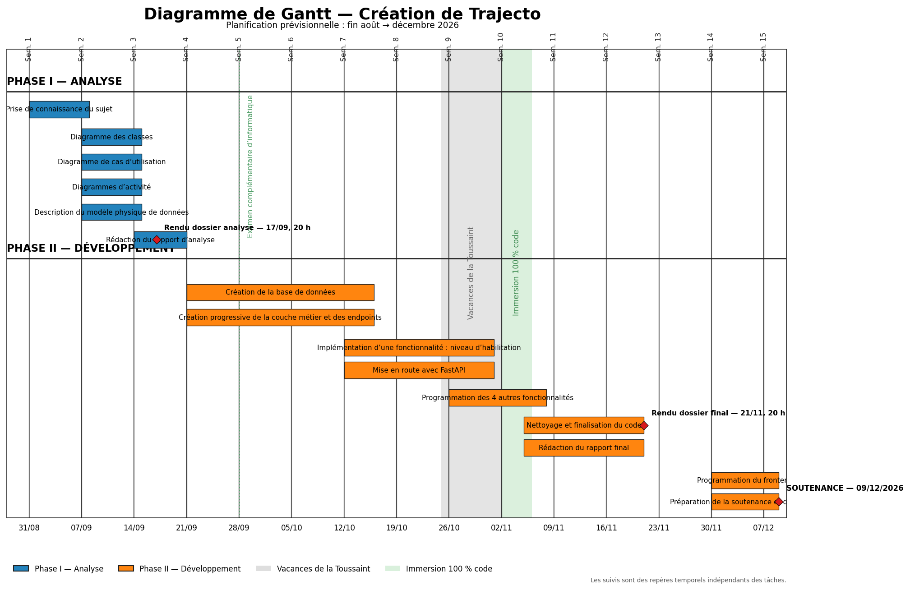
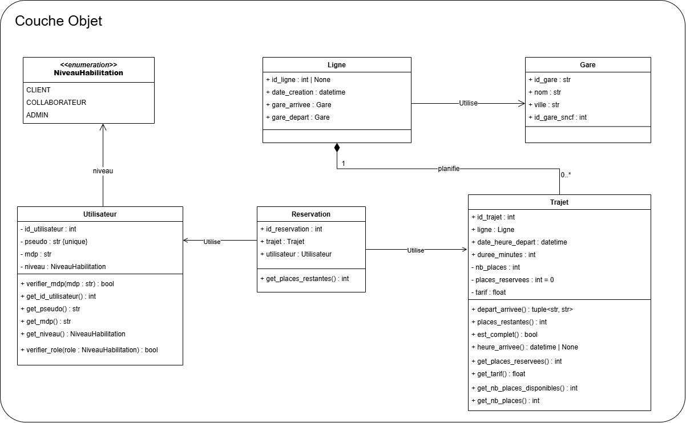
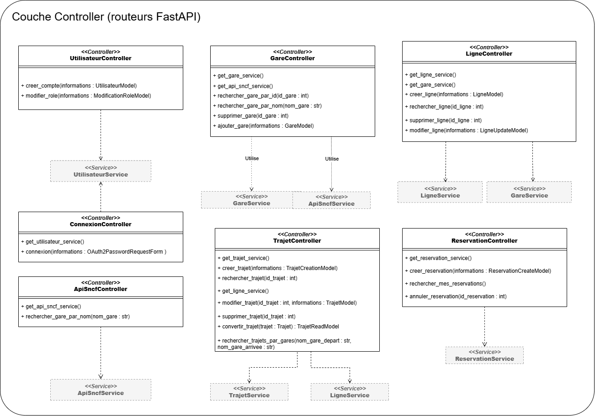
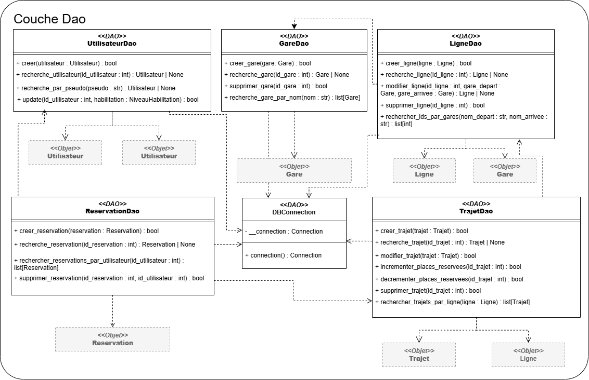
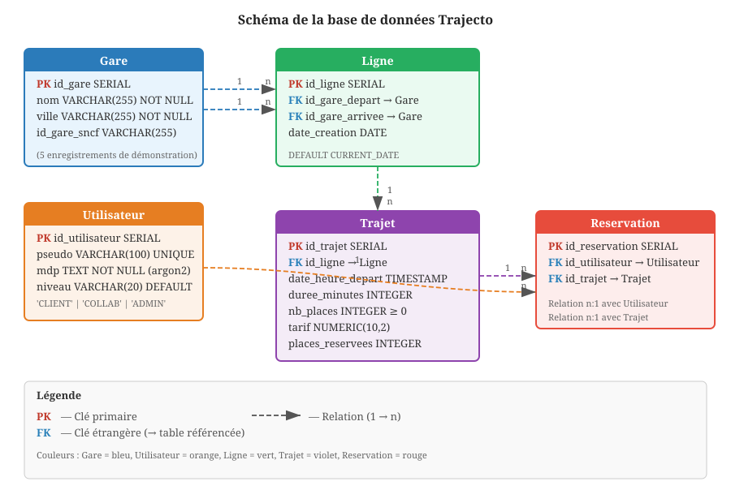

--- 
citeproc: false
nocite: "@*"
format:
  html:
    code-tools: true
  typst:
    papersize: a4
    margin:
      x: 1.5cm
      y: 2.0cm
    section-numbering: 1.1.a
    mainfont: "Libertinus Serif"
    fontsize: 11pt
---


```{=typst}
#import "model.typ": project_template

#show: body => project_template(
  title: [Trajecto : création d'une API de gestion de trajets ferroviaires],
  subtitle: [Rapport final],
  team: [Équipe 10],
  authors: ([Benjamin Blanc], [Manon Duquesne], [Hugo Lhommeau], [Jérémie L'Hostis], [Alexandre Yu]),
  tutor: [Kévin Leroy],
  project: [Projet Informatique de 2ème année - Année 2026-2027],
  body
)
```

## Introduction {.unnumbered}

Dans le cadre du projet informatique de deuxième année à l'ENSAI, notre équipe a été chargée de concevoir et de développer une application de gestion de trajets ferroviaires, baptisée Trajecto. Ce projet avait pour objectif de mettre en pratique les connaissances acquises en programmation et en conception logicielle, à travers la réalisation d'une application reposant sur une architecture client-serveur et une API permettant de manipuler des données persistantes.

Le développement de Trajecto répond à un besoin de mise en relation entre des trajets ferroviaires proposés par des collaborateurs et des utilisateurs souhaitant réserver une place. L'application permet ainsi de gérer les comptes utilisateurs et leurs habilitations, les gares, les lignes d'exploitation et les trajets proposés. Elle intègre également un mécanisme de réservation permettant aux clients de réserver une place sur un trajet et de consulter ou d'annuler leurs réservations.

Pour répondre à ces objectifs, nous avons choisi de développer une API REST en Python à l'aide du framework FastAPI, associée à une base de données relationnelle PostgreSQL. L'application s'appuie également sur l'API SNCF afin d'exploiter des informations ferroviaires externes, notamment pour rechercher des gares et déterminer la durée estimée des trajets. Enfin, un système d'authentification fondé sur les JSON Web Tokens (JWT) permet de contrôler l'accès aux différentes fonctionnalités selon le niveau d'habilitation des utilisateurs.

Au-delà de l'implémentation des fonctionnalités attendues, ce projet nous a conduits à réfléchir à l'organisation du code, à la modélisation des données et à la séparation des responsabilités entre les différentes composantes d'une application. Nous avons notamment adopté une architecture en couches distinguant les objets métiers, les contrôleurs, les services et les objets d'accès aux données, afin de faciliter la compréhension, la maintenance et l'évolution du programme.

Ce rapport présente les différentes étapes et les principaux résultats de notre travail. Il expose tout d'abord l'organisation du projet et sa modélisation, puis détaille les choix techniques et l'architecture retenue. Il décrit ensuite les fonctionnalités développées et leur utilisation, avant de présenter les tests réalisés et de dresser un bilan individuel et collectif de cette expérience.



## Organisation

La création de l'API s'est articulée en deux phases classiques : l'analyse, qui a eu lieu en parallèle des compléments de notre formation en informatique, et le développement, plus long et autonome, qui s'est concentré sur les trois jours d'immersion proposés par le cadre de notre formation, complété par un travil régulier tout le long des mois d'octobre et novembre.  

Chaque semaine ou presque, une réunion avait lieu avec l'équipe pour mettre en commun notre avancement et, surtout, lever les incertitudes qui pesaient sur nos choix d'implémentation et de solutions techniques liés au projet.

Nous avons réparti les rôles de façon non stricte, principalement en fonction des appétences combinées aux prises d'initiative précoces de chaque membre du groupe, avec quelques ajustements liés aux indisponibilités ponctuelles et à la difficulté que représente la coordination de cinq personnes autour d'un même environnement de travail.

Nous avons utilisé les outils idoines, liés à notre formation ENSAI, à notre disposition pour travailler : 

- VScode (principalement) pour programmer en Python;
- Postgres pour établir une connexion avec notre base de données;
- L'API de la SNCF, Navitia, pour récupérer les données utiles à nos instances de gares, lignes et trains;
- CloudBeaver pour manipuler et tester notre base de données de manière confortable et opérationnelle;
- Le datalab SSPcloud, maintenu par l'INSEE, pour simplifier la gestion de nos services logiciels nécessaires au développement.

### Chronologie du projet

{fig-align="center" width="120%"}

### Répartition des rôles

La répartition des tâches au sein de l'équipe a été volontairement souple, sans affectation rigide de chacun à un périmètre fermé. Les premières prises d'initiative, combinées aux appétences de chacun, ont naturellement fait émerger des axes de travail préférentiels : 

- La coordination du groupe et l'animation des réunions ont été assurées par Jérémie; 
- Benjamin s'est chargé de créer, maintenir et gérer la connexion à la base de données;
- Hugo s'est attaché au diagramme de classes et la synthèse plus générales des décisions architecturales prises par le groupe; 
- Manon a couvert, dans la phase d'analyse, les diagrammes de cas d'utilisation et d'activité;
- Alexandre s'est penché sur la description des fonctionnalités, les classes objet et l'intégration de l'API SNCF, ainsi que sur la partie numérique de la communication de travail dans le groupe.

En termes de programmation pure :

- La couche de contrôle (routeurs, schémas) a été initiée par Jérémie, avant qu'il ne corrige ou améliore graduellement les détails de tout le code;
- Benjamin a prolongé son travail de préparation et a codé la couche DAO presque en entier, et modifié lorsque c'était nécessaire les autres couches;
- Hugo et Alexandre ont étroitement collaboré sur les couches métier et services, lesquelles ont subi de nombreuses modifications au gré des contraintes que nous avons rencontré;
- Manon a programmé les tests unitaires et assuré le débuguage qui allait avec, donc une partie de la maintenance du code dans son ensemble.

Comme on le devine à cette description a posteriori, en pratique, chacun et chacune est régulièrement intervenu(e) sur des parties du code ou de l'analyse qui n'étaient pas son axe principal, et nous avons veillé à ce que tous les membres conservent une vision d'ensemble du code et de l'analyse, ce qui a facilité la relecture croisée, la correction des incohérences et le relais en cas d'indisponibilité ponctuelle.



## Modélisation finale

### Diagramme de classes final

La conception de notre projet est passée par la réalisation d'un diagramme de classes, nous permettant d'obtenir une vision d'ensemble des classes que nous souhaitions programmer et des relations entre celle-ci. Notre diagramme de classes se décompose en 4 couches : 

- *Couche Objet* : Cette couche comprend toutes les classes élémentaires de notre objet. Il s'agit des différents objets que nous manipulerons dans les autres couches du projet.

- *Couche Controller* : Cette couche fait l'intermédiaire entre l'interface et la couche service. Elle a pour but de d'amener les requêtes des utilisateurs vers les bons services. Il s'agit de plus de la classe qui sert à construire le Swagger de notre application.

- *Couche Service* : Elle recelle toutes les fonctionnalités demandées pour les différents objets. Elle fait appelle à la couche Dao pour récupérer les données contenues dans notre base de données et les données obtenues via des requêtes vers l'API Navitia de la SNCF. La couche service s'occupe également de vérifier les règles de gestion et les éventuels calculs.

- *Couche Dao* : Comme expliqué précedemment, cette classe reprend notamment les méthodes de la couche Service en allant chercher les données nécessaires.

Ce découpage en couches permet de respecter un principe central du développement d'applications : la séparation des responsabilités. Chaque couche a un rôle précis et ne connaît que la couche en-dessous d'elle. Cela permet notamment :

- Une meilleure *maintenabilité* : Etant donné que le projet est structuré, toute modification à apporter au projet est plus facile à réaliser. On peut également tester facilement les couches séparément (via notamment la mise en place de mock).

- Un *travail d'équipe* facilité : La répartition de l'écriture du code se fait plus facilement. On peut s'occuper à plusieurs d'une même fonctionnalité mais dans des couches différentes, c'est-à-dire sur des aspects différents de celle-ci.

#### Couche Objet

{fig-align="center" width="120%"}

#### Couche Controller {.unlisted}

{fig-align="center" width="120%"}

#### Couche Service {.unlisted}

{fig-align="center" width="120%"}

#### Couche Dao {.unlisted}


{fig-align="center" width="120%"}

### Schéma de base de données final

{fig-align="center" width="120%"}



### Choix techniques

### 3.2 Nos choix pour l'implémentation

Dans le cadre du développement de notre application de gestion de trajets ferroviaires, nous avons dû effectuer plusieurs choix technologiques afin de répondre aux besoins spécifiques du projet. Ces choix ont été guidés par la nécessité de construire une API performante, de garantir une gestion fiable des données et d'assurer la sécurité des interactions entre les différents utilisateurs. Voici les principales technologies retenues et les raisons qui ont motivé leur utilisation :

- **FastAPI pour la construction de l'API :** FastAPI est un framework Python moderne permettant de développer des API RESTful de manière rapide et efficace. Il offre notamment une documentation interactive générée automatiquement, une validation des données et une gestion simplifiée des requêtes HTTP. Dans notre projet, FastAPI permet de définir les différents endpoints nécessaires à la gestion des utilisateurs, des gares, des lignes, des trajets et des réservations. Sa documentation automatique, accessible via Swagger UI, facilite également les tests et la compréhension des fonctionnalités de notre application.

- **PostgreSQL pour la gestion des données :** PostgreSQL est un système de gestion de bases de données relationnelles open source, particulièrement adapté au stockage de données structurées. Notre application repose sur plusieurs entités liées entre elles, notamment les utilisateurs, les gares, les lignes, les trajets et les réservations. PostgreSQL permet de gérer efficacement ces relations tout en garantissant l'intégrité et la cohérence des données. L'utilisation de la base de données mise à disposition par l'ENSAI a également facilité le stockage centralisé des informations et le travail collaboratif.

- **L'API SNCF pour l'exploitation des données ferroviaires :** Afin de disposer d'informations relatives au réseau ferroviaire français, nous avons aussi utilisé l'API SNCF. Celle-ci permet d'accéder à des données externes concernant notamment les gares et les déplacements ferroviaires. Dans notre application, elle est notamment utilisée pour récupérer des informations permettant de déterminer la durée des trajets entre différentes gares. Son intégration nous évite de devoir constituer manuellement l'ensemble de ces données et permet de nous appuyer sur une source spécialisée.

- **JWT pour l'authentification et la gestion des accès :** Les JSON Web Tokens (JWT) constituent un mécanisme d'authentification reposant sur l'utilisation de jetons signés. Lorsqu'un utilisateur s'authentifie, un jeton peut lui être attribué afin de vérifier son identité lors des requêtes suivantes. Dans notre projet, ce système permet de sécuriser l'accès aux différentes fonctionnalités de l'API. Il est associé à une gestion des autorisations distinguant trois catégories d'utilisateurs : **CLIENT, COLLAB et ADMIN**. Chaque rôle dispose de permissions spécifiques, permettant notamment de restreindre certaines opérations de gestion aux utilisateurs habilités.

Ainsi, l'association de FastAPI, PostgreSQL, de l'API SNCF et des JWT permet de construire une application structurée, sécurisée et adaptée aux besoins de notre projet. Ces technologies répondent à des objectifs complémentaires : faciliter le développement de l'API, assurer la fiabilité du stockage des données, exploiter des informations ferroviaires externes et contrôler l'accès aux différentes fonctionnalités selon le profil de l'utilisateur.

### Architecture globale

L'architecture logicielle de notre application Trajecto repose sur une organisation en plusieurs couches, permettant de séparer les différentes responsabilités du programme. Cette structure favorise la modularité du code, facilite sa maintenance et permet de faire évoluer certaines fonctionnalités sans modifier l'ensemble de l'application. Chaque couche remplit ainsi un rôle spécifique, depuis la réception des requêtes des utilisateurs jusqu'à l'accès aux données stockées dans PostgreSQL ou récupérées depuis l'API SNCF.

Notre application s'articule autour de plusieurs composantes principales : la couche de contrôle (*Controller Layer*), la couche de services (*Service Layer*), la couche d'accès aux données (*DAO Layer*), les modèles métiers (*Business Objects*) et la couche de persistance (*Persistence Layer*). À celles-ci s'ajoute l'interaction avec l'API externe de la SNCF.

Voici l'arborescence de notre application :

```text
ensai-it-project-2a-team10/
├── backend/
│   ├── src/
│   │   ├── business_object/
│   │   ├── controller/
│   │   ├── dao/
│   │   ├── schema/
│   │   ├── service/
│   │   ├── utils/
│   │   └── main.py
│   ├── tests/
│   │   ├── tests_business_object/
│   │   └── tests_service/
│   ├── logging_config.yml
│   └── pyproject.toml
├── Diagrammes/
├── doc/
│   └── report/
│       └── rapport_final_equipe_10.qmd
├── README.md
└── requirements.txt
```
**La couche de contrôle (Controller Layer)** constitue le point d'entrée de notre application. Développée à l'aide du framework FastAPI, elle assure la communication entre les utilisateurs et les différentes fonctionnalités de Trajecto. Les interactions s'effectuent au moyen de requêtes HTTP, adressées à des endpoints organisés selon les principales entités de notre application : les utilisateurs, les gares, les lignes, les trajets et les réservations. Par exemple, l'endpoint `GET /trajet/` permet de rechercher des trajets entre deux gares, tandis que `POST /reservation/` permet d'effectuer une réservation. Le Controller réceptionne les requêtes, récupère les paramètres transmis, puis sollicite les traitements nécessaires à leur exécution. Il assure également la gestion des réponses HTTP, notamment en cas d'erreur ou lorsque les ressources demandées sont introuvables.

Cette couche intervient également dans la sécurisation de notre API. L'accès à la majorité des endpoints nécessite une authentification reposant sur l'utilisation de JSON Web Tokens (JWT). Lorsqu'un utilisateur se connecte via l'endpoint `/connexion/`, un jeton lui est attribué, qu'il doit ensuite transmettre lors de ses requêtes vers les endpoints protégés. Les autorisations dépendent de trois niveaux d'habilitation : CLIENT, COLLAB et ADMIN. Un CLIENT peut notamment gérer ses réservations, tandis qu'un COLLAB dispose de permissions supplémentaires pour créer, modifier ou supprimer des gares, des lignes et des trajets. Enfin, un ADMIN possède l'ensemble de ces droits et peut également modifier les habilitations des utilisateurs. Cette hiérarchisation permet de limiter l'accès aux fonctionnalités sensibles de notre application.

**La couche de services (Service Layer)** regroupe les traitements métiers nécessaires au fonctionnement de Trajecto. Elle constitue le cœur logique de l'application et permet de répondre aux demandes transmises par la couche de contrôle. Les traitements concernent notamment la gestion des trajets ferroviaires, la création de lignes entre différentes gares ou encore la réservation de places. Cette couche assure également la vérification des règles métiers propres à notre application. Par exemple, lors d'une réservation, le système doit vérifier l'existence du trajet demandé ainsi que la disponibilité des places avant de valider l'opération. De même, lors de l'annulation d'une réservation, le nombre de places réservées doit être actualisé afin de garantir la cohérence des disponibilités.

**La couche d'accès aux données (DAO Layer, pour Data Access Object)** assure les échanges entre les traitements de l'application et la base de données PostgreSQL. Elle permet de centraliser les opérations nécessaires à la consultation, à l'ajout, à la modification et à la suppression des informations. Ainsi, les traitements métiers peuvent s'appuyer sur des méthodes d'accès aux données sans avoir à gérer directement les requêtes SQL. Ce découpage permet de distinguer les opérations relatives au stockage des données de celles liées au fonctionnement métier de l'application.

**La couche de persistance (Persistence Layer)** correspond à notre base de données PostgreSQL. Celle-ci contient les différentes informations nécessaires au fonctionnement de Trajecto, réparties entre plusieurs tables représentant notamment les utilisateurs, les gares, les lignes, les trajets et les réservations. Les relations entre ces entités permettent de relier un trajet à une ligne ferroviaire, une ligne à ses gares de départ et d'arrivée, ou encore une réservation à un utilisateur et à un trajet. La base de données assure ainsi la conservation des informations, tandis que les opérations de consultation et de modification sont effectuées par l'intermédiaire de la couche d'accès aux données.

**Les modèles métiers (Business Objects)** représentent les principales entités manipulées dans notre application. Ils permettent de structurer les informations échangées entre les différentes composantes, notamment celles relatives aux gares, aux lignes, aux trajets, aux utilisateurs et aux réservations. En complément, les modèles de validation utilisés par FastAPI permettent de définir les données attendues dans les requêtes et les informations retournées dans les réponses. Cette organisation contribue à garantir la cohérence des données manipulées par notre API.

Enfin, **l'intégration de l'API SNCF** constitue une particularité importante de notre architecture. Contrairement aux informations stockées dans notre propre base de données, certaines données ferroviaires sont obtenues directement auprès d'un service externe. Notre application utilise notamment l'API SNCF pour rechercher des gares à partir de leur nom et récupérer des informations permettant de déterminer la durée d'un trajet. Lorsqu'un collaborateur crée un trajet via l'endpoint `POST /trajet/`, l'application exploite les noms des gares de départ et d'arrivée ainsi que la date et l'heure de départ pour obtenir une estimation de la durée auprès de l'API SNCF. Cette durée est ensuite associée au trajet créé. L'utilisation de cette API externe nous permet ainsi de compléter les données propres à Trajecto sans avoir à gérer manuellement l'ensemble des informations ferroviaires.

Le fonctionnement général de notre application repose donc sur les échanges entre ces différentes composantes. Lorsqu'un utilisateur effectue une requête depuis l'interface Swagger de FastAPI, celle-ci est réceptionnée par le Controller. Après validation des paramètres et vérification des éventuelles autorisations, les traitements nécessaires sont exécutés. Selon la fonctionnalité demandée, ils peuvent nécessiter la consultation ou la modification de données dans PostgreSQL, ou encore la récupération d'informations externes depuis l'API SNCF. Une fois les opérations terminées, les résultats sont retournés à la couche de contrôle, qui construit la réponse HTTP envoyée à l'utilisateur, généralement au format JSON.

Cette architecture permet donc de répartir les responsabilités entre les différentes composantes de Trajecto, tout en assurant leur communication. Elle facilite également les tests, la correction des erreurs et l'ajout de nouvelles fonctionnalités, sans nécessiter de modifications importantes dans l'ensemble du programme.

### Exemple détaillé d'une fonctionnalité

Afin d'illustrer le fonctionnement de notre application, nous allons détailler le processus de création d'un trajet ferroviaire par un collaborateur. Cette fonctionnalité mobilise les différentes couches de notre architecture, depuis l'authentification de l'utilisateur jusqu'à l'enregistrement du trajet dans la base de données PostgreSQL.

**Connexion et authentification de l'utilisateur**

L'utilisateur commence par se connecter à l'application à l'aide de son identifiant et de son mot de passe, notamment depuis l'interface Swagger. La requête `POST /connexion/` est reçue par le fichier Python du dossier `controller/` responsable de l'authentification. Celui-ci sollicite les traitements d'authentification, qui s'appuient sur les modules d'accès aux données du dossier `dao/` pour retrouver les informations de l'utilisateur dans PostgreSQL.

Après vérification des identifiants, l'application génère un JSON Web Token (JWT). Ce jeton, valable pendant sept jours, permet d'identifier l'utilisateur lors de ses prochaines requêtes sans qu'il ait à saisir de nouveau son mot de passe.

**Vérification du JWT et des habilitations**

Une fois connecté, le collaborateur peut demander la création d'un trajet en envoyant une requête `POST /trajet/`. Cette requête est dirigée vers le fichier Python du dossier `controller/` responsable des trajets.

Avant d'autoriser son exécution, FastAPI fait intervenir le module de sécurité chargé de vérifier le JWT transmis dans l'en-tête HTTP. Celui-ci contrôle la validité du jeton et l'identité de l'utilisateur, puis vérifie son niveau d'habilitation. La création d'un trajet nécessite au minimum le niveau `COLLAB` (niveau 2). Un utilisateur disposant uniquement du niveau `CLIENT` ne peut donc pas effectuer cette opération.

Si le jeton est absent, invalide ou expiré, l'application renvoie une erreur HTTP 401. Si l'utilisateur ne possède pas les autorisations nécessaires, la requête est refusée avec une erreur HTTP 403.

**Réception des informations et recherche de la ligne**

Une fois les autorisations vérifiées, le Controller chargé des trajets récupère les informations renseignées par le collaborateur : le nom de la gare de départ, le nom de la gare d'arrivée, la date et l'heure de départ, le nombre de places et le tarif.

Ces données sont validées à l'aide des modèles Pydantic définis dans les fichiers Python du dossier `schema/`. Le Controller sollicite ensuite les opérations d'accès aux données de la couche `dao/` afin de rechercher dans PostgreSQL une ligne ferroviaire reliant les deux gares indiquées.

Si cette ligne n'existe pas dans la base de données de l'application, une erreur HTTP 404 est renvoyée à l'utilisateur.

**Récupération de la durée auprès de l'API SNCF**

Lorsque la ligne existe, le traitement se poursuit par la détermination de la durée du trajet. Celle-ci n'est pas saisie manuellement par le collaborateur : elle est récupérée automatiquement grâce à l'API SNCF.

Le Controller instancie directement `ApiSncfService()` et appelle `calculer_duree_trajet()`, en lui transmettant les informations nécessaires à la recherche d'un itinéraire, notamment les gares concernées et l'horaire de départ.

Si l'API SNCF ne permet pas de trouver un itinéraire correspondant, l'application renvoie une erreur HTTP 422. Dans le cas contraire, la durée obtenue est utilisée pour compléter les informations du trajet.

**Création et enregistrement du trajet**

Une fois la durée obtenue, le Controller transmet l'ensemble des données au fichier du dossier `service/` responsable de la gestion des trajets. Le Service construit alors l'objet métier du nouveau trajet, défini dans le dossier `business_object/`.

Il sollicite ensuite le fichier Python du dossier `dao/` responsable des trajets, afin d'enregistrer le nouvel objet dans PostgreSQL. Le trajet est associé à la ligne ferroviaire identifiée précédemment et contient notamment sa date de départ, sa durée, son tarif et son nombre total de places. Le nombre de places réservées est initialisé à zéro.

Cette séparation entre le Service et le DAO permet de distinguer les règles métiers des opérations de lecture et d'écriture dans la base de données.

**Retour de la réponse à l'utilisateur**

Après l'insertion du trajet dans PostgreSQL, le DAO transmet le résultat au Service, qui le retourne au Controller. Ce dernier utilise le modèle de réponse défini dans la couche `schema/` pour construire la réponse HTTP au format JSON.

L'utilisateur reçoit alors les informations du trajet créé, notamment son identifiant, sa ligne ferroviaire, son horaire de départ, sa durée, son tarif et le nombre de places disponibles.

Cette fonctionnalité illustre ainsi la circulation des informations entre les différentes couches de notre application : le Controller gère les requêtes HTTP, interroge directement l'API SNCF et les DAO, les modules de sécurité contrôlent les accès, et le Service coordonne la construction de l'objet métier et son enregistrement via le DAO.




## Fonctionnalités implémentées

### Gestion des comptes utilisateur

#### Description {.unlisted}

Cette fonctionnalité permet de créer un compte, de s'authentifier et de gérer les niveaux d'habilitation.

- La création d'un compte (pseudo + mot de passe) attribue automatiquement le niveau **CLIENT**.
- Les mots de passe sont hachés (argon2) et jamais stockés en clair.
- Trois niveaux d'habilitation existent, du moins élevé au plus élevé :
  - **CLIENT** : recherche de trajets, réservation.
  - **COLLAB** : gestion des gares, lignes et trajets.
  - **ADMIN** : modification des habilitations des utilisateurs.
- Les niveaux sont cumulatifs : un COLLAB dispose également des droits CLIENT, et un ADMIN dispose des droits COLLAB et CLIENT. La vérification porte sur un niveau minimal requis, non sur un rôle exact.
- Seul un ADMIN peut modifier le niveau d'un autre utilisateur ; un ADMIN ne peut pas modifier le niveau d'un autre ADMIN.


#### Guide d'usage {.unlisted}

- **Créer un compte** : `POST /inscription/` avec un pseudo et un mot de passe. Le compte est créé avec le niveau CLIENT.
- **Se connecter** : `POST /connexion/` avec pseudo et mot de passe. Un JWT valable 7 jours est retourné, à transmettre dans l'en-tête `Authorization` des requêtes suivantes. Le token contient l'identifiant de l'utilisateur ainsi qu'une date d'expiration. Lorsqu'une requête protégée est reçue, le serveur vérifie la validité du jeton, puis retrouve le compte correspondant dans la base de données afin de déterminer son niveau d'habilitation et les autorisations associées.
- **Modifier une habilitation** (ADMIN uniquement) : `PUT /utilisateur/{id}/niveau` pour changer le niveau d'un utilisateur non-ADMIN.

*Exemple* : Alice crée un compte (niveau CLIENT). Un admin lui attribue le niveau COLLAB via l'endpoint de modification d'habilitation.

### Gestion des lignes d'exploitation

#### Description {.unlisted}

Cette fonctionnalité permet aux utilisateurs COLLAB et ADMIN de créer, modifier et supprimer des lignes reliant une gare de départ à une gare de terminus. La consultation par identifiant est accessible sans authentification.

Les gares sont identifiées par leurs identifiants SNCF, ce qui est plus robuste que la seule utilisation de leurs noms. Un endpoint dédié (`GET /api_sncf/{nom_gare}`) permet de rechercher des gares par nom partiel et d'obtenir leur identifiant SNCF correspondant. Règles de gestion :

- La création d'une ligne vérifie que les deux gares existent (via l'API SNCF) et qu'elles sont différentes.
- Une vérification empêche de créer deux fois la même liaison dans le même sens.
- La suppression d'une ligne est empêchée lorsqu'elle est encore référencée par des trajets, grâce à la contrainte de clé étrangère en base de données.

#### Guide d'usage {.unlisted}

- **Consulter les lignes** : `GET /ligne/` (liste) ou `GET /ligne/{id}` (détail, sans authentification).
- **Créer une ligne** (COLLAB) : `POST /ligne/` avec les gares de départ et de terminus validées par l'API SNCF.
- **Modifier une ligne** (COLLAB) : `PUT /ligne/{id}` pour changer la gare de départ, la gare de terminus ou les deux.
- **Supprimer une ligne** (COLLAB) : `DELETE /ligne/{id}` — refusée si des trajets y sont associés.

*Exemple* : Un collaborateur crée la ligne Rennes → Paris en saisissant les noms des deux gares, validées par l'API SNCF. La ligne est enregistrée et apparaît dans la liste.

### Gestion des trajets proposés

#### Description {.unlisted}

Cette fonctionnalité permet aux utilisateurs COLLAB et ADMIN de créer, modifier et supprimer des trajets associés à une ligne existante. La consultation est accessible sans authentification.

Un trajet est caractérisé par : la ligne d'exploitation, la date et l'heure de départ, le nombre de places et le tarif. La durée est calculée automatiquement via l'API SNCF : le plus court des itinéraires retournés est sélectionné, puis sa durée est convertie en minutes avec un arrondi supérieur. Le trajet enregistré conserve l'horaire demandé par le collaborateur, sans reprendre nécessairement l'horaire de départ de l'itinéraire sélectionné par l'API SNCF.

Règles de gestion :

- La ligne doit exister et l'API SNCF doit confirmer la faisabilité du trajet.
- Le nombre de places doit être strictement supérieur à zéro ; le tarif doit être positif ou nul.
- La modification d'un trajet ne provoque un nouvel appel à l'API SNCF que si la date de départ ou la ligne est modifiée ; les autres modifications conservent la durée précédemment enregistrée.


#### Guide d'usage {.unlisted}

- **Consulter les trajets** : `GET /trajet/` (liste) ou recherche entre deux gares, sans authentification.
- **Créer un trajet** (COLLAB) : `POST /trajet/` avec la ligne, la date/heure de départ, le nombre de places et le tarif. La durée est calculée automatiquement.
- **Modifier un trajet** (COLLAB) : `PUT /trajet/{id}`.
- **Supprimer un trajet** (COLLAB) : `DELETE /trajet/{id}`.

*Exemple* : Un COLLAB crée un trajet sur la ligne Rennes → Paris, au départ à 8h30, 80 places, tarif 35 €. L'API SNCF confirme la faisabilité et retourne une durée de 3h35. Le trajet est enregistré.

### Recherche d'un trajet

#### Description {.unlisted}
Cette fonctionnalité est accessible publiquement, sans authentification, et permet de rechercher les trajets proposés entre deux gares. Les gares sont validées via l'API SNCF et doivent être différentes.

Les résultats correspondent aux trajets enregistrés dans la base de données pour une liaison existante dans le sens demandé ; il ne s'agit pas d'une recherche de tous les itinéraires possibles sur le réseau SNCF.

La réponse renvoie pour chaque trajet trouvé : les gares de départ et d'arrivée, la date et l'heure de départ, et la durée du trajet. Un message est affiché si aucun résultat ne correspond.


#### Guide d'usage {.unlisted}

- **Rechercher des trajets** : `GET /trajet/?gare_depart=X&gare_arrivee=Y` — sans authentification. La liste des trajets correspondants est retournée.

*Exemple* : Un client recherche un trajet Rennes → Paris. Plusieurs trajets sont proposés avec leurs horaires et durées respectifs.

### Réservation

#### Description {.unlisted}

Cette fonctionnalité permet à tout utilisateur authentifié (CLIENT et supérieur) de réserver une place sur un trajet, de consulter ses réservations et d'annuler une réservation.

Règles de gestion :

- Le trajet doit exister et avoir au moins une place disponible (erreur 409 sinon).
- L'annulation est refusée si la réservation n'appartient pas à l'utilisateur connecté (erreur 403).
- Les compteurs de places réservées sont mis à jour automatiquement à la création et à l'annulation.

#### Guide d'usage {.unlisted}

- **Réserver** : `POST /reservation/` avec l'`id_trajet` — authentification CLIENT requise.
- **Consulter ses réservations** : `GET /reservation/mes-reservations` — retourne la liste avec les infos du trajet (horaire, durée, places, tarif).
- **Annuler** : `DELETE /reservation/{id_reservation}` — refusée si la réservation n'appartient pas à l'utilisateur.

*Exemple* : Alice recherche Rennes → Paris, réserve un trajet du matin. Elle consulte ses réservations pour confirmer. Elle annule ensuite : la place est libérée.



## Tests unitaires

### Méthodologie et architecture de test

Dans le cadre de la phase de réalisation du projet **Trajecto**, la mise en place d'une suite de tests automatisés a permis de sécuriser la logique applicative et de prévenir les régressions au fil des développements. Les tests unitaires ont été écrits avec **`pytest`** et organisés dans le répertoire `backend/tests/` (`tests_business_object/` et `tests_service/`), en cohérence avec notre architecture en couches (`business_object`, `dao`, `service`, `controller`).

L'objectif de cette démarche est de valider chaque composant de façon isolée, rapide et reproductible, sans dépendre d'une instance active de PostgreSQL, d'un appel réseau vers l'API Navitia de la SNCF ou d'une configuration sensible de production. Pour y parvenir, nous avons mobilisé plusieurs mécanismes d'isolation :

- **Simulation des dépendances (`MagicMock`)** : remplacement des méthodes d'accès aux données (`creer_gare`, `recherche_trajet`, `supprimer_reservation`, etc.), des appels externes (`api_sncf_service`) et des objets associés afin de maîtriser les valeurs retournées et de vérifier rigoureusement les interactions (appels attendus ou absence d'appel lors d'un échec via `assert_not_called()`).
- **Substitution ponctuelle (`monkeypatch`)** : surcharge temporaire de méthodes de classes ou de fonctions de modules durant l'exécution d'un test (notamment `GareService.recherche_gare` ou `TrajetDao.creer_trajet`), afin de préserver l'indépendance entre les scénarios.
- **Neutralisation de l'environnement d'exécution** : remplacement de `DBConnection` par un mock et définition de variables d'environnement factices (`SNCF_API_KEY`, `JWT_SECRET_KEY`) lors de l'initialisation des fichiers de test.

### Couverture fonctionnelle et cas vérifiés

La campagne de tests couvre à la fois les **cas nominaux** (comportement attendu en situation normale) et les **cas d'erreur ou cas limites** (données invalides, ressources absentes, conflits métier, défauts d'autorisation ou échecs de persistance).

#### Objets métiers {.unlisted}

Les tests de la couche `business_object` vérifient les règles internes et les calculs propres aux entités du domaine :

- **`Trajet`** : validation du calcul des places disponibles (`get_nb_places_disponibles` et `places_restantes()`), du décompte des places réservées, de la lecture du tarif, de l'identification des gares de départ et d'arrivée (`depart_arrivee()`), de l'état complet (`est_complet()`) ainsi que du calcul de l'heure d'arrivée (`heure_arrivee()`), y compris le cas limite d'une durée nulle (`0` minute) renvoyant `None`.
- **`Utilisateur`** : contrôle de l'instanciation et des accesseurs (`id_utilisateur`, `pseudo`, `niveau`), de la vérification des niveaux d'habilitation (`CLIENT`, `COLLAB`, `ADMIN`) et de la validation des mots de passe hachés via **`argon2`** (acceptation d'un mot de passe valide et rejet d'un mot de passe incorrect).

#### Services métiers {.unlisted}

Les tests de la couche `service` vérifient l'enchaînement des règles de gestion, la cohérence des appels vers la couche DAO et la levée des exceptions appropriées (`HTTPException` ou exceptions standards Python telles que `ValueError`, `LookupError`, `PermissionError` et `RuntimeError`) :

- **`GareService`** : vérification de l'ajout d'une gare lorsque l'arrêt est identifié via l'API SNCF et enregistré en base, ainsi que des cas d'erreur lorsque la gare est absente côté SNCF (`404`), lorsque la création en DAO échoue (`400`) ou lorsqu'une recherche ou suppression cible un identifiant inexistant (`404`).
- **`LigneService`** : validation de la création d'une ligne entre deux gares distinctes, de la recherche (par identifiant ou par couple de gares), de la modification et de la suppression. Les cas d'erreur couvrent l'identité des gares de départ et d'arrivée (`400`), l'existence préalable d'une ligne identique (`409`), l'échec d'insertion en DAO (`500`), l'absence de ligne lors d'une modification (`404`) ainsi que la présence de plusieurs lignes correspondantes lors d'une recherche par gares (`409`).
- **`ReservationService`** : contrôle des prérequis et des règles d'accès lors de la création et de l'annulation d'une réservation. Sont notamment vérifiés l'absence de trajet ou de réservation (`LookupError`), l'impossibilité de réserver sur un trajet complet (`ValueError`), le refus de l'annulation d'une réservation appartenant à un autre utilisateur (`PermissionError`) et la gestion d'un échec DAO (`RuntimeError`) sans modification des compteurs de places.
- **`TrajetService`** : vérification de la recherche et de la création d'un trajet (contrôle de l'objet retourné, de la durée et du tarif).
- **`UtilisateurService`** : validation de la création de compte, de la connexion, de la recherche d'utilisateur et de la modification d'habilitation par un administrateur. Les cas d'erreur couvrent un pseudo vide, un mot de passe trop court ou un pseudo déjà utilisé (`ValueError`), un utilisateur inconnu ou un mot de passe erroné lors de la connexion, ainsi qu'une tentative de modification d'habilitation par un utilisateur non administrateur (`PermissionError`).

### Résultats

Cette suite de tests unitaires apporte une garantie solide sur les règles métiers structurantes de **Trajecto** (gestion des capacités, contrôle des habilitations, validation des entrées et remontée des erreurs) et facilite la maintenance de l'application.

Des axes d'amélioration restent identifiés pour compléter cette validation : élargir la couverture des cas d'erreur sur `TrajetService` et des cas nominaux de `ReservationService`, uniformiser l'usage de `monkeypatch` sur l'ensemble des mocks de classes DAO. Cela dit, la couverture actuelle couvre les cas les plus risqués et s'est donc montrée safisfaisante à nos yeux pour un projet à cette échelle.



## Bilans individuels

### Jérémie L'Hostis

Ce projet fut pour l'occasion idéale pour me plonger dans deux rôles qui m'intéressent professionnellement : diriger une équipe (je me suis rapidement porté volontaire et mes comparses n'y ont pas vu d'inconvénient); et me plonger dans le développement complet d'une application informatique. J'ai par le passé effectué des études dont le contenu comportait de l'informatique, mais elles étaient davantage axées sur ses aspects théoriques : aborder le domaine parmi les ingénieurs était pour moi une démarche nouvelle. Comme toute la promotion, j'ai ainsi découvert avec intérêt les préoccupations d'architecture, de programmation en couches, de maintenance et d'autonomie en équipe, entre autres notions importantes pour lesquelles cette UE était un prétexte pertinent.

J'ai appris beaucoup de choses, mais deux aspects du déroulé ont retenu mon attention particulièrement :

- J'ai appréhendé la difficulté que représentait la coordination d'une équipe aux rythmes de travail, aux disponibilités et aux compétences variées, autour d'un même projet devant aboutir en un temps limité. Je n'étais moi-même pas le programmeur le plus chevronné du groupe et l'humilité qu'exige la nécessité de s'entraider sur ses lacunes respectivesa été un enseignement précieux; de même que la gestion des légers points d'inquiétude ou d'hésitations autour de l'avancement d'une partie ou d'une autre du projet. J'ai eu la chance de travailler dans un groupe très sérieux, où chaque personne a su être au rendez-vous quand c'était nécessaire, malgré quelques contretemps. J'ai pu alors mobiliser mon expérience professionnelle antérieure pour organiser, rassurer et garder une vue d'ensemble sereine qui nous a permis d'obtenir une application stable dans les temps. J'en suis très satisfait; et je pense par ailleurs que chacune des cinq personnes concernées peuvent être fières de leur travail.

- J'ai découvert, avec autant de circonspection que d'intérêt, la programmation et la relecture assistées par IA. En effet, l'époque où j'ai été initié en informatique (autour de 2016) précédait l'arrivée en force des LLM et leurs performances actuelles. J'ai eu la confirmation des aspects de ces nouveaux outils qui m'inquiètent le plus : la perte d'autonomie sur les tâches techniques fines si on ne surveille pas (ce qu'il faut faire, donc) la quantité de travail qu'on lui délègue, et la tentation à la paresse intellectuelle au moment de proposer ou examiner une solution à un problème. J'ai été rassuré de réaliser deux choses, cependant : le gain de productivité est bien réel à condition de savoir ce que l'on souhaite faire, et la nécessité de rigueur dans le travail n'est pas levée par ce type d'usage, puisqu'il faut avoir analysé correctement avant faire toute requête en amont, puis vérifier ce que la machine propose, relire et bien sûr comprendre en aval. Cela ne fait que gonfler mon intérêt pour les enseignements futurs dédiés au machine learning, car appréhender la manière dont ces assistants sont fabriqués est plus que jamais nécessaire dans des métiers tels que auxquels l'ENSAI prépare.

### Alexandre Yu

Ce projet a été particulièrement intéressant et enrichissant, notamment parce qu'il m'a permis de mieux comprendre le fonctionnement d'une API, les échanges de données à travers les requêtes HTTP, ainsi que les interactions entre le frontend, le backend et le serveur. J'ai pu approfondir mes connaissances concernant la sécurité des données et les mécanismes nécessaires pour protéger les échanges entre les différentes parties de l'application.

L'un des principaux enseignements que je retiens de ce projet concerne l'importance de définir une architecture claire dès le début du développement. En effet, nous avons été amenés à revoir plusieurs classes et à ajouter de nouveaux modules, notamment pour intégrer les mécanismes de sécurité. 

J'ai ainsi pris conscience qu'une conception initiale bien réfléchie, accompagnée de diagrammes adaptés, permet de mieux anticiper les besoins du projet et de limiter les modifications importantes en cours de développement. On réalise rapidement que la principale difficulté du projet ne résidait pas nécessairement dans l'implémentation technique des fonctionnalités, mais davantage dans la manière de les concevoir et de les intégrer correctement à l'ensemble de l'application, tout en respectant les bonnes pratiques de développement et en gardant une architecture cohérente.

La gestion des erreurs a également représenté un point important. À mesure que l'application gagne en complexité, les interactions entre les composants se multiplient et rendent le débogage plus difficile. Il était donc essentiel de prévoir des messages explicites et de bien identifier l'origine des erreurs afin de faciliter le débogage et de permettre de corriger plus rapidement les problèmes rencontrés. Ce projet m'a permis de prendre conscience de l'importance de bien définir les erreurs et de gérer les dépendances entre les différents modules.

Dans l'ensemble, ce projet a été une expérience plutôt enrichissante. Il m'a permis de mieux appréhender les enjeux liés à la conception d'une application dans sa globalité. Je retiens particulièrement l'importance de la réflexion architecturale, du respect des bonnes pratiques et de la qualité des échanges entre les différentes parties d'une application.

### Hugo Lhommeau

Ce projet informatique m'aura offert la possibilité de mieux appréhender un travail en groupe, d'approfondir mes connaissances en informatique et ma pratique du code. Pour commencer, je vais aborder la question du travail collectif. Je parlerai ensuite des apports personnels de ce projet, et je finirai en donnant quelques améliorations possibles en ce qui concerne mon travail en lui-même.

Ce projet informatique m'a conforté dans l'idée que l'organisation même du projet était peut-être l'élément le plus important, devant la maîtrise des notions abordées, pour la réussite de celui-ci. Dès le début, Jérémie a proposé d'occuper le rôle de chef de groupe de notre projet. Il a tenu parfaitement ce rôle en s'assurant que chacun avait des rôles et des tâches bien particulières et en organisant des points hebdomadaires afin de discuter de l'avancée du projet. Le projet informatique de première année m'avait permis de constater que l'absence de chef de groupe était délétère pour la réussite du projet, justement parce que les tâches à effectuer n'étaient pas bien réparties et car une forme de procrastination s'installait. Toutefois, l'utilité du chef du groupe repose aussi grandement sur les autres membres du groupe, leur réactivité et leur capacité à suivre les tâches et rôles répartis. Il est ainsi arrivé que nous travaillions à plusieurs sur une même tâches sans s'être préalablement coordonné, entraînant donc une perte de temps. Pour conclure cette partie, ce projet m'aura permis de mieux comprendre comment travailler efficacement en groupe. De plus, la très bonne organisation de ce projet est à l'origine selon moi du bon déroulement de celui-ci. Le fait de travailler avec de nouvelles personnes nécessite d'avoir une bonne organisation et nous force à nous intéresser à tous les aspects du projet.

C'est un projet qui m'aura également donner l'occasion d'approfondir mes connaissances en informatique. Il s'agissait tout d'abord d'une application de l'organisation par couches [objet|Controller|Service|Dao] vue en début de deuxième année. Cette notion est loin d'être simple à comprendre et à pratiquer, et c'est grâce en grande partie à ce projet et à l'aide de notre tuteur que j'ai pu la comprendre. Je me suis également notamment occupé de la rédaction du diagramme de classes du projet informatique. La structure en couches du projet a rendu en particulier intéressante et stimulante sa rédaction. Enfin, ce projet a évidemment été à nouveau l'occasion de pratiquer la programmation orientée objet.

Comme après n'importe quel projet, j'ai noté quelques améliorations possibles dans mon travail. En premier lieu, j'ai le sentiment de n'avoir pas assez codé. je dirais que cela est notamment dû à l'efficacité d'autres membres du groupe. J'ai également des améliorations à faire en ce qui concerne la communication pour éviter tout perte de temps et d'énergie. Il est arrivé ponctuellement que nous travaillions à plusieurs sur une même tâche. A l'avenir, il faudra éviter que cela se reproduise. De plus, cela a été la source de quelques conflits git dont on aurait pu se passer.

En définitive, ce projet informatique aura été une expérience riche à plusieurs égards. Sur le plan collectif, il m'a montré que l'organisation, portée par un chef de groupe investi et des points réguliers, conditionne largement la réussite d'un projet, à condition que chacun soit réactif et communique sur ce qu'il fait. Sur le plan personnel, il m'a permis de mieux comprendre l'architecture en couches, d'approfondir la programmation orientée objet et la réalisation d'un diagramme de classes. Il m'a aussi permis d'identifier des points sur lesquels je pouvais m'améliorer: coder davantage et mieux communiquer afin d'éviter les doublons de travail et les conflits git. Ces enseignements me serviront dans mes futurs projets où je veillerai à m'impliquer davantage dans la réalisation technique tout en maintenant une bonne coordination avec mes coéquipiers.


### Benjamin Blanc

J'ai trouvé le projet informatique de cette année très intéressant et, de mon côté, plus abouti que celui de l'année dernière. En effet, j'ai eu l'impression de mieux comprendre les rouages du projet et la façon dont il était articulé. Ainsi, je comprenais mieux chaque étape, ce qui rendait sa réalisation moins compliquée d'un point de vue technique.

Le fait de comprendre la structure du projet m'a aussi aidé lors du développement, notamment dans l'utilisation des LLM. En effet, je pense que leur utilisation ne peut aujourd'hui être négligée, compte tenu du gain de productivité qu'ils offrent. Cependant, j'ai passé beaucoup moins de temps à leur faire des requêtes, car, puisque je comprenais ce que je leur demandais, mes prompts étaient plus clairs et plus précis. Je n'avais donc pas besoin de perdre autant de temps à guider l'IA pour qu'elle comprenne ce que je voulais faire. Ainsi, j'ai compris que, bien que les LLM soient devenus des outils très importants pour le développement informatique, il reste essentiel que la personne qui pilote le projet comprenne ce qu'elle fait afin d'être réellement productive.

Le fait que le projet ait été bien cadré dès le départ, que nos objectifs aient été clairement définis et que nos diagrammes aient été clairs et corrects a également contribué à son bon déroulement, pour les mêmes raisons que celles citées précédemment. Cela nous a permis d'avoir une vision globale du projet et de savoir plus précisément où nous allions, tout en facilitant le développement des différentes fonctionnalités.

Ce projet a aussi été pour moi l'opportunité de découvrir comment les bases de données étaient réellement utilisées dans une application. En effet, venant d'un BUT Science des données, j'ai beaucoup travaillé sur le SQL et la gestion de bases de données, mais ces cours restaient assez théoriques. Grâce à ce projet et à l'application que nous avons réalisée, j'ai pu comprendre concrètement comment relier une base de données à une application répondant à un véritable besoin. Cela m'a permis de donner davantage de sens aux connaissances que j'avais acquises auparavant.

J'ai également découvert le fonctionnement d'une API et son rôle dans une application informatique. Avant ce projet, je ne comprenais pas vraiment comment les différentes parties d'une application pouvaient communiquer entre elles. J'ai notamment appris comment une requête envoyée par un utilisateur pouvait être reçue par une API, traitée par le programme, puis conduire à une interaction avec la base de données avant de renvoyer une réponse. J'ai aussi mieux compris l'intérêt de séparer les différentes responsabilités du code, notamment entre les routes, la logique métier et l'accès aux données. Cette découverte m'a permis de mieux comprendre le fonctionnement global d'une application et la manière dont ses différents composants interagissent. C'est probablement l'un des aspects les plus enrichissants de ce projet pour moi, car il m'a permis de découvrir une dimension du développement informatique que je connaissais encore assez peu.

Pour finir, ce projet a été pour moi très enrichissant, tant sur le plan technique que sur le plan humain. Son bon déroulement a aussi été rendu possible grâce à un groupe qui fonctionnait très bien. Le travail était sérieux et bien organisé, chacun connaissait son rôle et s'investissait dans la réalisation du projet.


### Manon Duquesne

Ce projet informatique a constitué une expérience formatrice, en particulier parce qu'il m'a permis d'appréhender concrètement le fonctionnement d'une application structurée en couches et la manière dont les différentes briques logicielles interagissent entre elles. En travaillant sur la mise en place de la suite de tests unitaires par exemple, j'ai dû analyser en détail les objets métiers, les services ainsi que les échanges avec la base de données et l'API externe, ce qui m'a donné une vision d'ensemble de l'application.

Je comprends maintenant davantage l'intérêt concret de la séparation des responsabilités. Écrire des tests unitaires avec pytest, en isolant les dépendances grâce aux mocks et au monkeypatching, m'a montré à quel point un découpage clair entre les couches (business_object, service, dao) facilite la vérification du code. À l'inverse, lorsque des dépendances sont couplées ou que des états sont partagés, l'écriture des tests devient plus délicate et révèle des points d'amélioration possibles dans la structure du programme.

Cette phase de test m'a également sensibilisée à l'importance de la rigueur sur les cas limites et les règles de gestion. Au-delà du fonctionnement nominal, il est indispensable d'anticiper les situations d'erreur, données invalides, ressources introuvables, conflits ou défauts d'habilitation, et de vérifier que les exceptions levées restent cohérentes. Adopter cette démarche m'a aidée à développer un regard plus attentif à la fiabilité et à la maintenabilité du code.

Enfin, sur le plan collectif, ce projet m'a permis de travailler sur un dépôt Git partagé, de m'approprier du code écrit par d'autres membres de l'équipe et de contribuer à fiabiliser l'application avant la livraison finale. Il m'a aidée à consolider mes bases en programmation orientée objet et à mieux mesurer le rôle des tests dans la qualité d'un projet informatique.



## Conclusion {.unnumbered}

La réalisation de Trajecto nous a permis de mettre en œuvre les principales étapes du développement d'une application informatique structurée autour d'une API. À travers ce projet, nous avons conçu une architecture logicielle en plusieurs couches, modélisé des entités métier, développé des fonctionnalités de gestion de données et mis en place des mécanismes d'authentification et de contrôle des habilitations.

L'association de FastAPI et de PostgreSQL nous a permis de construire un backend organisé, capable de gérer les comptes utilisateurs, les gares, les lignes ferroviaires, les trajets proposés et les réservations. L'intégration de l'API SNCF constitue également un apport important du projet : elle permet de compléter les données internes par des informations ferroviaires externes, notamment pour rechercher des gares et estimer la durée des déplacements. La mise en place d'une authentification par JWT et d'une hiérarchie de permissions contribue, quant à elle, à encadrer l'accès aux différentes opérations.

Le développement de l'application a néanmoins mis en évidence plusieurs difficultés inhérentes à un projet informatique collectif. La définition d'une architecture cohérente, l'organisation des interfaces entre les différentes couches et la prise en compte des dépendances entre les entités ont nécessité des ajustements au cours du développement. L'intégration progressive de nouvelles fonctionnalités a également souligné l'importance de maintenir une modélisation et une organisation du code suffisamment rigoureuses pour éviter les incohérences.

Ce travail nous a ainsi permis de mieux comprendre que le développement d'une application ne se limite pas à l'écriture de fonctionnalités indépendantes. Il nécessite également d'anticiper leurs interactions, de garantir la cohérence des données et de prévoir les situations d'erreur. La mise en place de tests et l'utilisation d'outils de gestion de versions ont notamment contribué à accompagner ce travail collectif.

Enfin, Trajecto constitue une base fonctionnelle sur laquelle des évolutions pourraient être envisagées, notamment en matière d'interface utilisateur, d'enrichissement des fonctionnalités de réservation et de renforcement des mécanismes de validation et de sécurisation. Le projet a donc constitué une expérience formatrice, tant sur le plan technique que sur celui de la conception et du développement collaboratif, en nous confrontant aux différentes dimensions de la réalisation d'une application informatique.
